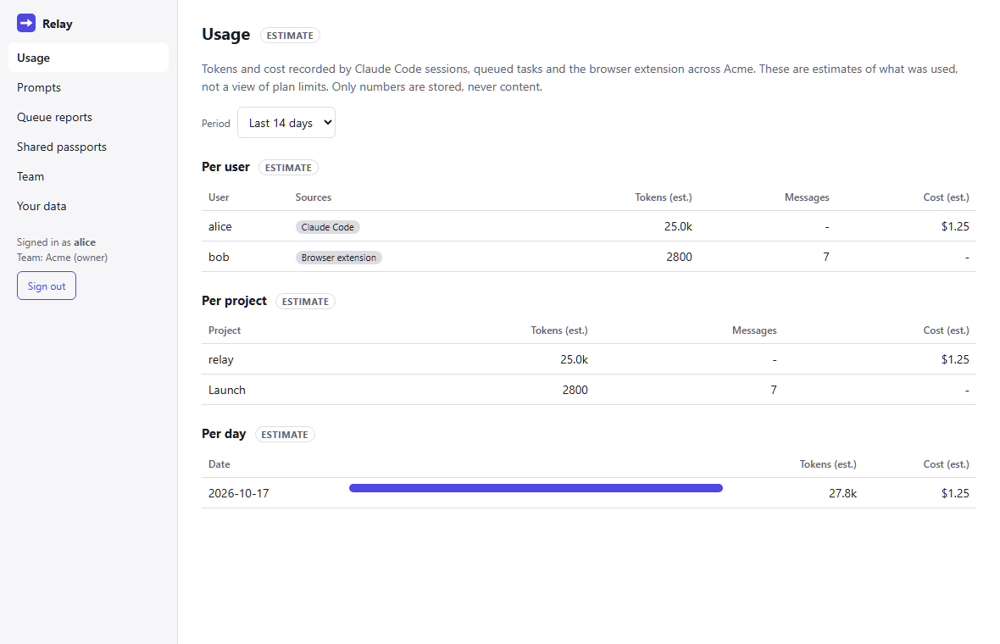
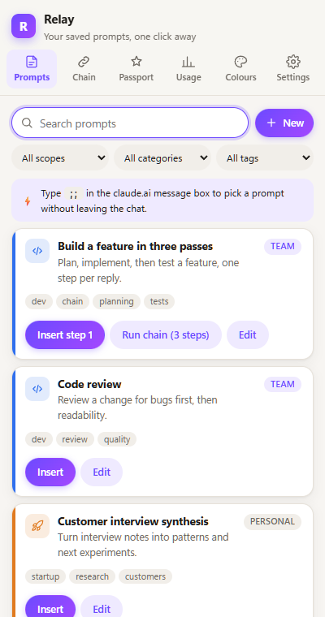
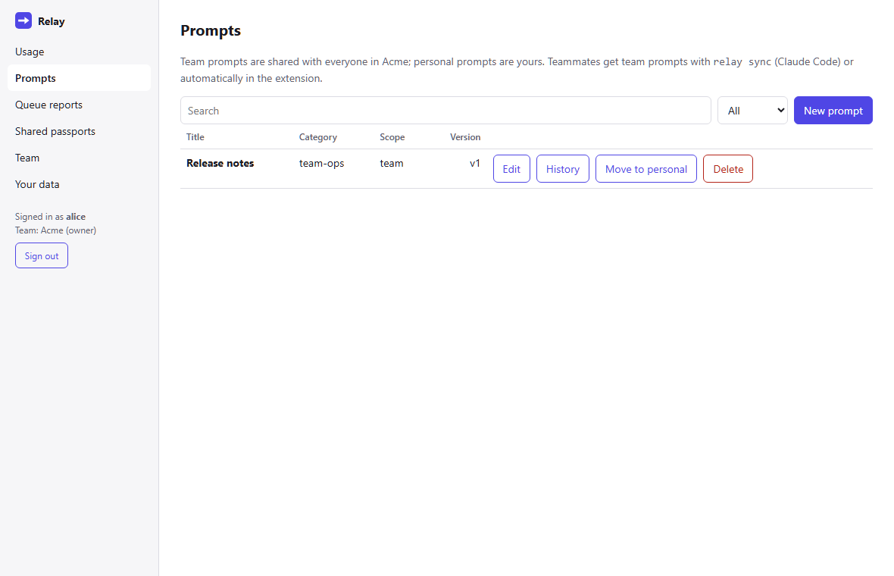

# ReSync

**Saved prompts, handoffs and usage tracking for Claude Code and claude.ai, plus a work queue that waits out usage limits.** Built for small teams; it works for one person too. Bring your own AI models and keys if you want, or use none at all.

> **ReSync works fully without API keys.** Every AI feature (Context Passport, topic tree, summary) runs *in-chat* by default: ReSync sends the prompt inside your current Claude chat or Claude Code session, on the plan you already have. API mode, with your own provider and key, is optional.

> **Disclaimer:** ReSync is an independent open-source project. It is **not affiliated with, endorsed by, or supported by Anthropic**. The Chrome extension reads and fills the claude.ai page, and **may break when claude.ai changes**. When that happens, ReSync shows a banner instead of failing silently, and you can adjust its selectors in Settings.



## What's inside

| Part | What it does |
|---|---|
| **Claude Code plugin** (`/resync:*`) | Saved prompts as slash commands (`/resync:dev-code-review`), `/resync:passport` handoff briefs, `/resync:resume`, `/resync:tree` (JSON + Mermaid mindmap), `/resync:summary`. A reminder to save a passport after auto-compaction. A statusline with today's usage. |
| **`resync` CLI** | **Limit-Aware Work Queue:** queue coding tasks that run headless overnight, each in its own git worktree and `resync/<task-id>` branch. When a usage limit hits, the task waits for the reset and then retries. Also `resync usage` tables, API-mode passports, keys in the OS keychain, and team sync. |
| **Chrome extension** (claude.ai) | Project colours, a prompt library with a `;;` quick picker and `{{variables}}` forms, multi-step chains that wait for each reply (with timers, pause and skip), passport, topic tree and summary (read aloud), a 7-day usage estimate chart, a **Team Decision Ledger** ("your team's AI remembers what you decided, and why": decisions from passports, a banner when a message goes against one, supersede history), and a **Chat Health Meter** with one-click handoff to a fresh chat in the same project. |
| **Team server + dashboard** (optional) | Invite-only teams, shared team prompts with version history, usage per person, project and day, overnight queue reports, and shared handoffs. Self-host it with one `docker compose up`. |
| **Provider layer** | One interface for Anthropic, OpenAI, Gemini, OpenRouter and any OpenAI-compatible server (Ollama, LM Studio). Route each feature to its own model. See [docs/PROVIDERS.md](docs/PROVIDERS.md). |

## 5-minute quick start

You need **Node.js 20+** and **git**. Claude Code is needed for the plugin and the queue.

```sh
git clone <this repo> resync && cd resync
npm install
npm link -w @resync/cli            # puts `resync` on your PATH
resync --help
```

**1. Claude Code plugin (saved prompts, passport, tree, summary):**
```sh
resync plugin install              # registers the plugin with Claude Code (resync@resync-local)
resync statusline install          # optional: model, context, session cost, today's total
```
Start a new Claude Code session and try `/resync:prompts`, then `/resync:passport`.

**2. The work queue:**
```sh
resync queue add "Fix the failing date tests" --repo .   # default tools: read, edit, run tests
resync queue run --at 02:00                              # or: resync queue run / resync queue watch
resync queue list
```
Each task runs on its own `resync/<task-id>` branch in a separate worktree. ReSync never touches `main`, never merges and never pushes. A report lands in `.resync/queue-reports/`.

**3. Chrome extension:**
```sh
npm run build -w @resync/extension
```
Open `chrome://extensions`, turn on **Developer mode**, click **Load unpacked**, and choose `packages/extension/dist`. Open claude.ai and click the ReSync icon to open the side panel. In the message box, type `;;` to pick a prompt.

**4. Team server and dashboard (optional, self-hosted):**
```sh
docker compose up --build
```
Open <http://localhost:8787> and sign in with the development login (local trial only). Create a team, then point the CLI (`resync config set serverUrl http://localhost:8787 && resync login`) and the extension (Settings > Team server) at it. For a real deployment with GitHub/Google sign-in, see [docs/SELF_HOSTING.md](docs/SELF_HOSTING.md).

Teammates: follow [docs/SETUP.md](docs/SETUP.md).

## Screenshots

| Extension side panel | Dashboard: prompts |
|---|---|
|  |  |

## Privacy in one paragraph

API keys stay on your device: in the OS keychain (CLI) or encrypted with your passphrase (extension). They are never sent to the ReSync server. Conversations stay local. Only prompt libraries, settings, colours and usage **numbers** sync, and only if you use a server. A passport or summary reaches your team only when you click **Share**. Decision Ledger text syncs only if your team owner allows it and you turn it on (both off by default), with secrets, emails and phone numbers removed first. In API mode, the conversation text goes to the provider you chose, and ReSync tells you so before the first send. There is no telemetry. Details: [docs/SECURITY.md](docs/SECURITY.md).

## Development

```sh
npm test                               # all unit and API tests (Vitest; the server uses an in-memory MongoDB)
npm run lint
npm run test:e2e -w @resync/extension   # extension in Chromium against a mock claude.ai page
npm run test:e2e -w @resync/dashboard   # dashboard smoke tests against the real server
```
See [CONTRIBUTING.md](CONTRIBUTING.md), [docs/DECISIONS.md](docs/DECISIONS.md) (why things are the way they are) and [docs/VERIFIED.md](docs/VERIFIED.md) (every external interface checked against official docs).

## License

[MIT](LICENSE)
